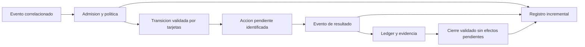

# Candidatos y antipatrones del harness — 30 de septiembre de 2026

## Resultado y alcance

Estado historico previo al cambio. La implementacion y el estado actualizado de
estos candidatos se documentan en [coordinador por eventos](../architecture/implementacion-coordinador-eventos-2026-09-30.md).

Se identificaron **18 candidatos: 2 criticos, 8 altos, 6 medios y 2 bajos**.
La revision es estatica del codigo actual. Los escenarios descritos son rutas
posibles sustentadas por la implementacion; no se ejecutaron nuevos escenarios
de fallo ni llamadas remotas en esta auditoria. Las pruebas propuestas abajo son
criterios para validar las futuras correcciones.

El recorrido NVIDIA y el selftest de la validacion anterior acreditan un camino
correcto. No acreditan los contratos de admision, cierre, recuperacion y orden que
faltan en los casos de esta revision.

Se aplica el requisito del proyecto: **los eventos activan las operaciones; las
tarjetas autorizan y validan su progreso; el modelo propone acciones**. El avance
por turnos, por numero de iteraciones o por preguntas periodicas al modelo no
debe ser el eje de ejecucion.

Actualmente `EventDrivenAgent` espera el bus de forma asincrona, pero sigue
heredando de `StateMachine` y siendo ejecutado por `AgentLoopRunner.RunAsync`,
que llama repetidamente a `StepAsync`. La migracion de la entrada CLI al reactor
fue real; la eliminacion del coordinador por iteraciones sigue pendiente.

## Severidades

| Rango | Criterio aplicado |
| --- | --- |
| Critico | Puede declarar cumplido un objetivo incorrecto o permitir efectos fuera del contrato de tarjetas. |
| Alto | Puede romper la activacion por eventos, bloquear el control, perder trabajo o incumplir restricciones operativas. |
| Medio | Degrada consistencia, memoria, frescura o trazabilidad bajo condiciones concretas. |
| Bajo | Deuda de configuracion y mantenimiento con impacto operativo acotado. |

La severidad describe el impacto dentro de este harness; no es una clasificacion
de vulnerabilidades de seguridad externas.

## Inventario priorizado

| ID | Rango | Gap / antipatron | Candidato de mejora |
| --- | --- | --- | --- |
| C01 | Critico | Herramientas fuera de transaccion y efectos despues del cierre | Admision obligatoria por estado de tarjetas, antes de cada efecto |
| C02 | Critico | Cierre con evidencia insuficiente | Contrato de aceptacion tipado y evidencia vinculada al objetivo |
| A01 | Alto | El coordinador principal sigue siendo un loop de pasos | Coordinador con handlers de eventos y transiciones autorizadas |
| A02 | Alto | Esperas de herramientas ocupan el reactor; deadline parcial | Herramientas como operaciones pendientes con eventos de resultado |
| A03 | Alto | Instrumentacion puede romper el resultado y el protocolo | Observacion aislada y un resultado registrado por cada llamada |
| A04 | Alto | Restricciones declaradas sin aplicacion central | Admision comun de tools, rutas, modelo y politica efectiva |
| A05 | Alto | Retiro de eventos sin confirmacion ni recuperacion | Registro de eventos, confirmacion y recuperacion de operaciones |
| A06 | Alto | Admision de procesos con carrera de concurrencia | Reserva atomica de capacidad y liberacion al finalizar |
| A07 | Alto | El operador no puede publicar instrucciones durante una operacion | Entrada independiente con eventos de control |
| A08 | Alto | Retroalimentacion de Aviso/Latido vuelve a consultar al LLM | Recuperacion por causa y plazo, con deteccion de falta de progreso |
| M01 | Medio | Cola pendiente y traza sin limites conjuntos | Capacidad, prioridad y agrupacion por tipo de evento |
| M02 | Medio | Orden, deduplicacion y conteo tienen contratos ambiguos | Identidad causal, orden por operacion y contadores separados |
| M03 | Medio | Esperadores cancelados permanecen en la cola | Retirar registros al cancelar o expirar |
| M04 | Medio | Cache de snapshots de procesos durante 30 segundos | Invalidacion por eventos o lectura directa de estado vivo |
| M05 | Medio | Observadores de salida sin timeout ni retiro | Limitar regex y gestionar ciclo de vida de watchers |
| M06 | Medio | Limite de contexto no gobierna contrato y parte actual | Presupuestos separados y referencias a evidencia fuera del prompt |
| B01 | Bajo | Opciones de reintento y limites sin fuente unica | Validacion de opciones y configuracion efectiva visible |
| B02 | Bajo | Entradas y composition root duplican el montaje | Una ruta de composicion y ejecucion para todas las entradas |

## Evidencia y condiciones de cada candidato

### C01 — Las tarjetas validan otras tarjetas, pero no todos los efectos

**Evidencia:** [DispatchAsync](../../src/AgentLoop.Compatibility/Reactor/LegacyEventDrivenAgent.cs), lineas 430 y 505;
[OperationTools](../../src/AgentLoop.Harness/Tools/OperationTools.cs), lineas 111 y 150;
[CardLedger](../../src/AgentLoop.Core/Cards/CardLedger.cs), linea 247.

El dispatcher ejecuta todo el lote y consulta `GoalMet`/`Aborted` despues del
`foreach`. `ejecutar` y `lanzar` reciben el supervisor, sin verificar apertura del
ledger. Las herramientas de archivo agregadas al CLI tampoco consultan tarjetas.
El ledger rechaza nuevas tarjetas despues del cierre; eso no impide otros efectos.

**Escenarios:** ejecutar un comando sin `abrir`; o recibir un lote con `cerrar`
seguido de `write_text_file` que reemplaza el artefacto ya verificado. El cierre
puede quedar aceptado aunque el resto del lote cambie el resultado.

**Mejora:** una puerta de admision por accion y estado de la transaccion, aplicada
antes de cada herramienta. El cierre/aborto termina la admision de nuevos efectos.
Definir explicitamente que lecturas de preparacion se permiten antes de abrir.
Resolver las llamadas restantes con resultados de rechazo, sin dejar tool calls
pendientes en el protocolo del proveedor.

**Validacion futura:** efecto antes de abrir rechazado; lote que cierra y luego
escribe no modifica disco; rechazo de tarjeta no habilita efectos posteriores.

### C02 — Verificado no equivale a cumplir el objetivo

**Evidencia:** [CardLedger](../../src/AgentLoop.Core/Cards/CardLedger.cs), lineas 78 y 343;
[AcceptanceCriteria](../../src/AgentLoop.Core/Goals/AcceptanceCriteria.cs), lineas 21 y 74;
[EvidenceManifest](../../src/AgentLoop.Infrastructure/Files/EvidenceManifest.cs), linea 44.

`comprobar` marca la transaccion como verificada a partir de sus campos. Si el
objetivo no contiene una ruta reconocida, no se exige evidencia automatica.
Para archivos se exige existencia y contenido no vacio; no contenido correcto,
procedencia de esta operacion ni correspondencia con una comprobacion exitosa.
Un archivo antiguo o ajeno al objetivo puede satisfacer ese control. La regex de
rutas ademas excluye espacios y reconoce una lista limitada de extensiones.

**Mejora:** criterios tipados desde la admision del objetivo: artefacto esperado,
validadores de contenido, observacion o resultado de proceso requerido. `comprobar`
debe referenciar evidencia identificada y registrada por el sistema. `cerrar`
valida el conjunto de criterios y el resultado vigente, incluidos objetivos sin archivo.

**Validacion futura:** archivo no vacio pero incorrecto rechazado; evidencia de
otro objetivo rechazada; ruta absoluta con espacios resuelta completa; objetivo
sin ruta no puede cerrarse solo con una afirmacion del modelo.

### A01 — La senal de eventos convive con un runner por iteraciones

**Evidencia:** [AgentLoopRunner](../../src/AgentLoop.Compatibility/Conversation/AgentLoopRunner.cs), lineas 61 y 125;
[GoalRunner](../../src/AgentLoop.Harness/Runner/GoalRunner.cs), linea 76;
[Program](../../tests/AgentLoop.SelfTests/Program.cs), lineas 228 y 1053.

El runner avanza fases con `StepAsync` y limita pasos con `MaxIterations`, calculado
a partir de llamadas al modelo. Las esperas actuales si se suspenden asincronamente;
este hallazgo no afirma que exista un giro continuo consumiendo CPU. La dependencia
arquitectonica del loop de pasos, sin embargo, sigue presente y contradice el
requisito de que el eje sea la recepcion de eventos.

**Mejora:** handlers de `ObjetivoRecibido`, `ResultadoModelo`,
`SolicitudHerramienta`, `ResultadoHerramienta`, `TarjetaAceptada/Rechazada`,
`Cancelacion` y `DeadlineAlcanzado`. Cada handler aplica una transicion legal;
el evento y el estado habilitan el trabajo. Los limites pasan a ser presupuestos
de recursos y eventos de control, con motivos de salida especificos.

**Validacion futura:** el camino principal no usa `AgentLoopRunner`; ninguna
operacion avanza por incrementar un contador de pasos; sin evento habilitante
no se solicita razonamiento.

### A02 — Await evita bloquear un hilo, pero puede ocupar el control del reactor

**Evidencia:** [EventDrivenAgent](../../src/AgentLoop.Compatibility/Reactor/LegacyEventDrivenAgent.cs), lineas 140 y 430;
[OperationTools](../../src/AgentLoop.Harness/Tools/OperationTools.cs), lineas 111 y 201;
[BuiltInTools](../../src/AgentLoop.Infrastructure/Tools/BuiltInTools.cs), lineas 73 y 84.

El despacho espera herramientas una por una, incluyendo `ejecutar` y `esperar`.
Los productores siguen publicando, pero el reactor no consume esos eventos hasta
que vuelve del despacho. Esta fase queda fuera del watchdog del objetivo. Algunas
tools tienen su propio timeout; escribir archivos es sincrono e ignora el token.
Por otra parte, `BreakWhen` corta por `Expired` tambien al entrar en despacho,
aunque los comentarios del reactor describen una excepcion para esa fase.

**Mejora:** separar admision, inicio y finalizacion. Registrar acciones pendientes
y recibir su resultado por evento. Definir que ocurre con una accion admitida
cuando vence el plazo: cancelacion cooperativa, compensacion o finalizacion
controlada. El cierre exige resolver pendientes segun esa politica.

**Validacion futura:** evento de control atendido durante una accion lenta;
deadline clasificado de manera unica; cierre imposible con efectos pendientes
que puedan alterar la evidencia.

### A03 — Los callbacks aun influyen en el resultado del negocio

**Evidencia:** [EventDrivenAgent](../../src/AgentLoop.Compatibility/Reactor/LegacyEventDrivenAgent.cs), lineas 370,
457 y 465; [EventBus](../../src/AgentLoop.Harness/Events/EventBus.cs), linea 55;
[ProcessSupervisor](../../src/AgentLoop.Infrastructure/Execution/Processes/ProcessSupervisor.cs), linea 388.

`OnModelCall` y `OnToolCall` se invocan directamente. Si `OnToolCall` lanza, ya pudo
ocurrir el efecto, pero el resultado aun no se agrego a `Messages`. Otros caminos
de error del despacho hacen `continue` sin fabricar el resultado correspondiente.
El siguiente request puede contener tool calls sin respuesta. El evento
`HerramientaFinalizada` se publica antes de agregar el resultado al contexto.

El bus captura excepciones de observadores, pero los invoca sincronicamente:
un observador lento o colgado retrasa al publicador. En `ProcesoFin`, eso tambien
retrasa la apertura de `Terminado`, que se realiza despues de publicar.

**Mejora:** registrar un resultado por llamada antes de anunciar finalizacion;
aislar instrumentacion mediante su propia entrega acotada. Los fallos de
observacion deben generar diagnostico sin cambiar el resultado operativo.

**Validacion futura:** callback que lanza o queda esperando no bloquea el cierre
del proceso; efecto ejecutado conserva su resultado; errores producen respuestas
de herramienta completas.

### A04 — La configuracion declarada no se aplica de forma uniforme

**Evidencia:** [Scope](../../src/AgentLoop.Harness/Security/Scope.cs), lineas 27 y 38;
[GoalRunFactory](../../src/AgentLoop.Infrastructure/Composition/GoalRunFactory.cs), linea 76;
[Program](../../tests/AgentLoop.SelfTests/Program.cs), lineas 200 y 211;
[BuiltInTools](../../src/AgentLoop.Infrastructure/Tools/BuiltInTools.cs), linea 73.

La busqueda de usos de `AllowsModel`, `AllowsTool` y `AllowsPath` solo encuentra
sus definiciones. Las herramientas se exponen sin aplicar esas restricciones.
`AllowsPath` compara prefijos: una raiz `C:\trabajo` tambien coincide con
`C:\trabajo-ajeno`. La escritura directa de archivos no pasa por `ExecutionPolicy`.
El CLI interactivo crea una politica nueva con valores por defecto; sus opciones
de shell, cwd, politica y concurrencia no se propagan por esa ruta.

**Mejora:** admision central y politica efectiva compartida entre entradas.
Validar limites de directorio completos y la semantica de simulacion/confirmacion
para cada herramienta con efectos.

**Validacion futura:** tool y ruta fuera de scope rechazadas; simulacion nunca
escribe; opciones aceptadas por CLI aparecen en la politica realmente aplicada.

### A05 — No hay entrega recuperable de eventos ni efectos

**Evidencia:** [EventBus](../../src/AgentLoop.Harness/Events/EventBus.cs), linea 155;
[EventDrivenAgent](../../src/AgentLoop.Compatibility/Reactor/LegacyEventDrivenAgent.cs), linea 325;
[FileRunStore](../../src/AgentLoop.Infrastructure/Persistence/FileRunStore.cs), linea 51;
[Program](../../tests/AgentLoop.SelfTests/Program.cs), linea 241.

`Drain` retira eventos antes de terminar la reaccion. El parte queda en memoria,
pero no hay confirmacion de consumo ni recuperacion tras caida. Los informes se
persisten al terminar; `FileRunStore` reemplaza el destino mediante `File.Create`,
sin intercambio atomico. Tampoco se reconstruyen operaciones pendientes o el
ledger desde un registro durable. La cancelacion puede impedir persistir al usar
el token ya cancelado; el runner absorbe cancelacion en su resultado y `GoalRunner`
puede clasificarla como `Failed` sin entrar en su catch de `Cancelled`.

**Mejora:** registro incremental de admisiones, tarjetas, eventos y resultados,
con confirmacion, escritura atomica e identificadores de acciones. Definir
recuperacion y reconciliacion de efectos inciertos; no prometer ejecucion unica
solo por deduplicar eventos.

**Validacion futura:** interrupcion tras retirar un evento o ejecutar un efecto
conserva informacion para recuperarlo sin repetir ciegamente; cancelacion deja
un estado terminal y evidencia persistida.

### A06 — Comprobar Running no reserva una plaza

**Evidencia:** [ProcessSupervisor](../../src/AgentLoop.Infrastructure/Execution/Processes/ProcessSupervisor.cs), lineas
187, 193 y 219.

Se compara `Running` con `MaxConcurrent`, luego se espera `Puerta`, y despues se
arranca y registra el proceso. Dos callers pueden superar el limite al observar
simultaneamente la misma capacidad disponible. Varios callers esperando la
puerta pueden ser liberados juntos sin nueva reserva atomica.

**Mejora:** reserva de capacidad vinculada al ciclo de vida del proceso y liberada
por su finalizacion o fallo de arranque. Conservar el reset event manual como
puerta de pausa/reanudacion; la capacidad es otro contrato.

**Validacion futura:** multiples lanzamientos simultaneos con `MaxConcurrent=1`
producen como maximo un proceso vivo, incluso al reabrir la puerta.

### A07 — La entrada del operador comparte el tiempo de la operacion

**Evidencia:** [Program](../../tests/AgentLoop.SelfTests/Program.cs), lineas 100 y 163.

El CLI lee una linea y espera toda la operacion antes de leer la siguiente.
Ctrl+C tiene un canal aparte, pero nuevas instrucciones, pausa, cambio de prioridad
o solicitud de estado no llegan al bus durante una operacion activa.

**Mejora:** productor de entrada independiente que publique comandos de control
correlacionados con el objetivo, con respuestas de aceptacion o rechazo segun
estado y tarjetas. Cambiar de modelo requiere un punto de admision definido.

**Validacion futura:** pausa y consulta de estado procesadas mientras el modelo
razona o un proceso sigue vivo, sin esperar a que termine el objetivo.

### A08 — Eventos sinteticos pueden recrear el ciclo de repreguntas

**Evidencia:** [EventDrivenAgent](../../src/AgentLoop.Compatibility/Reactor/LegacyEventDrivenAgent.cs), lineas 99,
316 y 408.

Sin procesos vivos, el timeout de espera produce `Latido`. Una respuesta sin
tools produce `Aviso`, que vuelve a habilitar razonamiento. `TextOnlyStreak`
crece pero no impone una politica terminal de estancamiento. La deduplicacion
temporal del bus no mide progreso del objetivo.

**Mejora:** recuperacion con causa, numero acotado de intentos y comprobacion de
progreso del ledger/efectos. Programar un evento de recuperacion solo cuando hay
una accion pendiente que lo justifique; distinguir bloqueo, error y espera legitima.

**Validacion futura:** modelo que responde repetidamente texto alcanza un estado
de bloqueo/fallo explicito sin consultar hasta consumir todo el presupuesto.

### M01 — Capacidad y prioridad de eventos pendientes

**Evidencia:** [EventBus](../../src/AgentLoop.Harness/Events/EventBus.cs), lineas 18 y 27;
[StepRecorder](../../src/AgentLoop.Harness/Observability/Steps/StepRecorder.cs), linea 18.

El historial del bus se limita a 500, pero la cola pendiente y la cola de steps
no tienen capacidad maxima. No hay prioridad para control frente a salida.
**Mejora:** agrupacion de salida y capacidad definida, conservando eventos de
tarjetas, error y cierre; metricas de profundidad y tiempo en cola.
**Validacion futura:** rafaga de salida mantiene memoria acotada y no retrasa control.

### M02 — Identidad de hecho, orden y conteo

**Evidencia:** [EventBus](../../src/AgentLoop.Harness/Events/EventBus.cs), lineas 45, 86, 103 y 131;
[StepRecorder](../../src/AgentLoop.Harness/Observability/Steps/StepRecorder.cs), metodos `NextSequence` y `Record`.

Asignar un sequence y encolar son acciones separadas: con publicadores concurrentes
el orden de cola puede diferir del numero. `Published` incluye intentos descartados.
La deduplicacion por texto y separadores puede colapsar hechos distintos o claves
ambiguas; no hay causation ID ni run ID en el propio `AgentEvent`.
**Mejora:** identidad por evento/accion, deduplicacion especifica por tipo y
contrato de orden explicito. Separar intentados, admitidos, descartados y consumidos.
**Validacion futura:** dos hechos con texto igual permanecen distintos y los
consumidores pueden reconstruir la causalidad concurrente.

### M03 — Cancelar marca el waiter, pero no lo retira

**Evidencia:** [ResetEvents](../../src/AgentLoop.Kernel/Concurrency/AsyncManualResetEvent.cs), lineas 83, 150 y 165.

Los waiters vencidos o cancelados se retiran cuando llega un `Set` posterior.
Si solo hay cancelaciones/timeouts, permanecen acumulados en `_waiters`.
**Mejora:** registro removible y limpieza al terminar la espera.
**Validacion futura:** muchas esperas canceladas sin publicaciones mantienen
constante el numero de registros retenidos.

### M04 — Idempotencia aplicada a estado mutable

**Evidencia:** [OperationTools](../../src/AgentLoop.Harness/Tools/OperationTools.cs), lineas 34 y 43.

`procesos` cachea un snapshot durante 30 segundos. Una consulta posterior puede
seguir mostrando procesos vivos que ya terminaron; el parte general si consulta
al supervisor directamente y puede contradecir ese resultado cacheado.
**Mejora:** invalidar por eventos de proceso o leer el snapshot actual sin cache.
**Validacion futura:** nueva consulta inmediatamente despues de `ProcesoFin`
coincide con el estado del supervisor.

### M05 — Watchers sin presupuesto ni retiro

**Evidencia:** [ProcessSupervisor](../../src/AgentLoop.Infrastructure/Execution/Processes/ProcessSupervisor.cs), lineas
21, 48, 279 y 323.

La regex indicada por el modelo se ejecuta sin timeout bajo el lock de watchers.
Un patron costoso puede retener la captura de salida. Los watchers se conservan
despues de disparar y no hay retiro por expiracion de una espera.
**Mejora:** timeout de regex, cantidad maxima y estados expirado/cancelado/disparado.
**Validacion futura:** patron costoso termina con error acotado y no impide eventos
de otros procesos; watchers expirados dejan de consumir recursos.

### M06 — Contexto protegido puede exceder el presupuesto anunciado

**Evidencia:** [GoalContext](../../src/AgentLoop.Harness/Operations/GoalContext.cs), linea 103;
[Program](../../tests/AgentLoop.SelfTests/Program.cs), linea 217;
[EvidenceManifest](../../src/AgentLoop.Infrastructure/Files/EvidenceManifest.cs), linea 44.

La poda conserva sistema y parte actual. Los antecedentes van dentro del sistema,
por lo que el limite de historial no puede recortarlos en el reactor. Una tool
puede leer un archivo entero; la evidencia tambien carga el archivo entero para
calcular su hash. El guard de caracteres falla al exceder el tope, sin recuperar
el contexto mediante referencias.
**Mejora:** presupuestos separados para contrato, recuerdos, parte y resultados;
lecturas acotadas, hashes en streaming y referencias a evidencia registrada.
**Validacion futura:** artefacto grande no consume memoria proporcional al archivo
ni exige reenviar su contenido completo al modelo.

### B01 — Configuracion que aparenta controlar algo distinto

**Evidencia:** [EventDrivenAgent](../../src/AgentLoop.Compatibility/Reactor/LegacyEventDrivenAgent.cs), constructor y
propiedad `MaxTransientFailures`; [RetryPattern](../../src/AgentLoop.Harness/Resilience/RetryPattern.cs).

`MaxTransientFailures` se muestra en mensajes, pero el patron se construye con
`maxAttempts: 3` fijo. Tambien faltan validaciones de valores como `EventsPerBrief`
e `IdleSlice`; un lote de cero eventos no puede producir una reaccion util.
**Mejora:** validar opciones y construir patrones desde la configuracion efectiva.
**Validacion futura:** el numero real de reintentos coincide con el configurado.

### B02 — Varias entradas montan caminos diferentes

**Evidencia:** [Program](../../tests/AgentLoop.SelfTests/Program.cs), metodos `AgentOperationAsync` y `GoalAsync`;
[GoalRunner](../../src/AgentLoop.Harness/Runner/GoalRunner.cs);
[GoalRunFactory](../../src/AgentLoop.Infrastructure/Composition/GoalRunFactory.cs), linea 198.

CLI, goal y journal configuran runners y evidencia de forma distinta. El helper
de persistencia construye un setup y llama a un runner que vuelve a construir otro.
Esto facilita divergencias en tools, memoria, presupuestos y estado terminal.
**Mejora:** un composition root y coordinador operativo; las entradas solo
publican objetivos con configuracion validada y reciben eventos de resultado.
**Validacion futura:** el mismo objetivo tiene igual contrato y catalogo efectivo
en CLI, goal y journal, salvo diferencias declaradas.

## Uso de reset events en el diseno objetivo

`AsyncManualResetEvent` es apropiado para estado persistente: puerta de ejecucion
abierta/cerrada y latch de proceso terminado. Muchos consumidores pueden observar
el mismo estado. `AsyncAutoResetEvent` sirve para despertar un consumidor del bus;
los datos viven en la cola. Una senal no sustituye la identidad de cada evento,
su confirmacion, prioridad o registro durable.

Usar estas primitivas mejora las esperas, pero por si solo no define el contrato
de activacion del trabajo. El coordinador debe reaccionar a eventos admitidos y
las tarjetas deben gobernar efectos y cierre.

## Orden recomendado de trabajo

1. **Integridad:** C01 y C02. Poner la puerta de tarjetas frente a los efectos y
   vincular comprobacion/cierre a criterios y evidencia reales.
2. **Eje de eventos:** A01, A02, A07 y A08. Sustituir el runner principal por
   handlers, separar acciones pendientes y habilitar entrada de control independiente.
3. **Fiabilidad:** A03, A04, A05 y A06. Completar resultados, aislar observadores,
   aplicar politica, reservar capacidad y persistir admision/resultados.
4. **Carga y mantenimiento:** los seis medios y los dos bajos. Acotar recursos,
   definir causalidad, invalidar estado y unificar configuracion/composicion.

Los criterios de validacion de esta auditoria deben probar el contrato observable:
efectos permitidos, eventos recibidos, estados de tarjetas y evidencia aceptada.
Contar iteraciones o verificar que el modelo produjo texto no acredita esos contratos.
