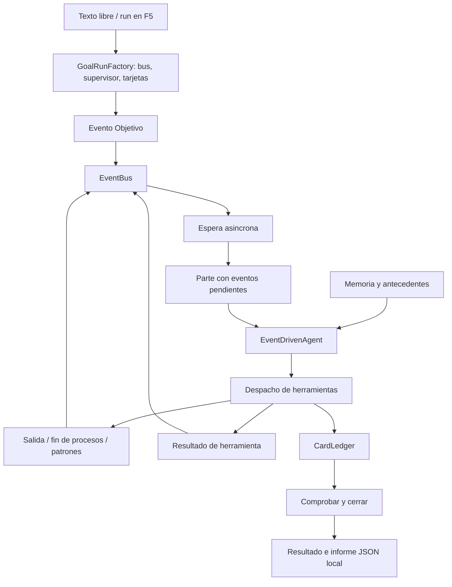

# Validacion de la arquitectura por eventos — 2026-09-28

> Informe historico de la revision indicada en el documento. El comportamiento vigente esta en el [coordinador por eventos](implementacion-coordinador-eventos-2026-09-30.md) y el [indice documental](README.md). Los resultados originales se conservan como evidencia.

## Hallazgo inicial

El proyecto tenia dos motores, y F5 entraba al conversacional:

| Entrada anterior | Motor | Criterio de exito |
| --- | --- | --- |
| Texto libre, `run` y `chat` dentro del CLI | `AgentStateMachine` | Respuesta final del LLM |
| `run` fuera del CLI | `AgentStateMachine` | Respuesta final del LLM |
| `goal`, `journal` | `EventDrivenAgent` | Libro mayor comprobado y cerrado |

La arquitectura de eventos ya existia en `Events/`, `Goals/`, `Terminals/` y
`Harness/`. El problema principal de entrada era que el CLI no la utilizaba para
las tareas habituales. La gestion de memoria anterior solo estaba conectada al
motor conversacional.

La suite anterior pasaba: [registro antes](evidence/eventos-antes-2026-09-28.log).
Se agregaron casos que reprodujeron defectos reales:
[regresion antes de corregir](evidence/eventos-regresion-antes-2026-09-28.log).

## Flujo principal validado el 28 de septiembre



Los mensajes `system/user/assistant/tool` siguen existiendo porque son el formato
del proveedor. No fijan el criterio de activacion ni de exito del reactor.
`Cycles` cuenta llamadas al modelo; no significa que un usuario deba contestar
para avanzar. Los limites de ciclos y tiempo son cortes de seguridad y no
declaran cumplido un objetivo.

## Correcciones

1. Texto libre y `run` en el CLI ahora ejecutan el reactor. `run` desde la linea
   de comandos es alias de `goal`. `chat` sigue siendo una utilidad explicita;
   `run-chat` conserva el antiguo comando de tool calling por turnos.
2. `EventBus.WaitAsync` comprueba la cola tras despertar y conserva el plazo de
   espera: una senal antigua de un evento ya drenado no habilita otra reaccion.
3. `AsyncAutoResetEvent` retira logicamente esperadores cancelados y evita perder
   una senal en la carrera entre cancelacion y publicacion.
4. Los errores de callbacks de observacion no interrumpen la publicacion ni el
   despertar. Se contabilizan en `ObserverFailures`.
5. `ReasonAsync` vuelve a esperar si no hay eventos. No envia partes vacios al LLM.
6. Cada resultado de herramienta produce `HerramientaFinalizada` o `Error`, con
   identificador de llamada. Las herramientas de lectura ya no dependen de un
   latido para que el reactor procese sus resultados.
7. El estado de un proceso terminado se actualiza antes de publicar `ProcesoFin`.
   El latch se abre despues de publicarlo para que los consumidores que esperan
   ese latch encuentren tambien el evento en el bus.
8. El CLI incorpora recuerdos y antecedentes al contrato del reactor. Guarda el
   resultado de cada operacion en el historial y un informe en
   `.agentloop/operations/<fecha>-<id>.json`, excluido de Git. El informe contiene
   eventos recientes, tarjetas, mensajes vivos, resultado y consumo reportado.
9. El contexto del reactor tiene recorte por tamano y fronteras de partes;
   mantiene el contrato y el parte actual. Una peticion JSON mayor de 600000
   caracteres falla antes de enviarse. No equivale a un limite exacto de tokens.

## Pruebas reproducibles

```powershell
dotnet build --nologo
dotnet bin/Debug/net9.0/AgentLoop.dll selftest-events
dotnet bin/Debug/net9.0/AgentLoop.dll selftest
dotnet bin/Debug/net9.0/AgentLoop.dll interactive --deadline 180 --max-ciclos 10
```

`selftest-events` usa clientes deterministas y un proceso local real. Comprueba
cancelacion, senales antiguas, observadores defectuosos, 500 publicaciones
concurrentes, drenado parcial, ausencia de llamadas sin eventos, resultados de
herramientas, eventos que llegan durante el razonamiento, espera con proceso
silencioso, salida, patron, fin y conexion del CLI. Tambien recorre una operacion
completa con suma real por herramienta, comprobacion, cierre y evidencia local.

Resultados locales: 19 comprobaciones especificas correctas y suite completa
`SELF-TEST OK`. Compilacion sin errores; permanecen las dos advertencias previas
CS8602 y CS8625.

- [Regresiones despues](evidence/eventos-regresion-despues-2026-09-28.log)
- [Suite completa despues](evidence/eventos-despues-2026-09-28.log)
- [Validacion final del 30 de septiembre](evidence/eventos-final-2026-09-30.log):
  recompilacion correcta y `SELF-TEST OK` con los ultimos ajustes.

La ejecucion real con NVIDIA `z-ai/glm-5.3` tambien termino con codigo 0:
6 llamadas al modelo, 11 eventos publicados, 6 herramientas y 3 tarjetas
aceptadas (`abrir`, `comprobar`, `cerrar`), en 178 segundos. Obtuvo `17 + 23 = 40`,
escribio un memo de 142 bytes y lo leyo antes de cerrar. El modelo genero
razonamiento aunque la prueba omitio el parametro de thinking (`--thinking off`).
El reactor consumio 9 eventos: los dos eventos finales quedaron registrados tras
el cierre y no requieren otra llamada al modelo.

- [Traza NVIDIA](evidence/eventos-nvidia-2026-09-28.log)
- Memo local: `.agentloop/eventos-validacion-nvidia-2026-09-28.txt`.
- Informe de la operacion:
  `.agentloop/operations/20260928-072733-491bafdddefb4d4588c9dff53c86f518.json`.

La llamada mas lenta consumio aproximadamente 120 segundos. El exito de esta
prueba acredita el recorrido completo; la latencia del proveedor sigue siendo
variable y puede agotar el presupuesto de otras operaciones.

## Alcance

El reactor espera eventos mientras un proceso esta vivo. Si no hay procesos ni
eventos y el objetivo sigue abierto, genera un `Latido`; una respuesta del modelo
sin herramientas genera un `Aviso` de recuperacion. Son eventos internos
explicitos, acotados por los presupuestos.

La consola admite un objetivo a la vez; aun no recibe nuevas instrucciones del
operador mientras ese objetivo esta en marcha. Los procesos y sus eventos si
continuan de forma asincrona durante el razonamiento. Cada objetivo tiene su
propio bus y libro mayor; el historial no restaura procesos ni operaciones abiertas.
El bus es local y en memoria, no una cola durable. El informe usa el historial
acotado del bus (500 eventos), no promete conservar una traza ilimitada.
